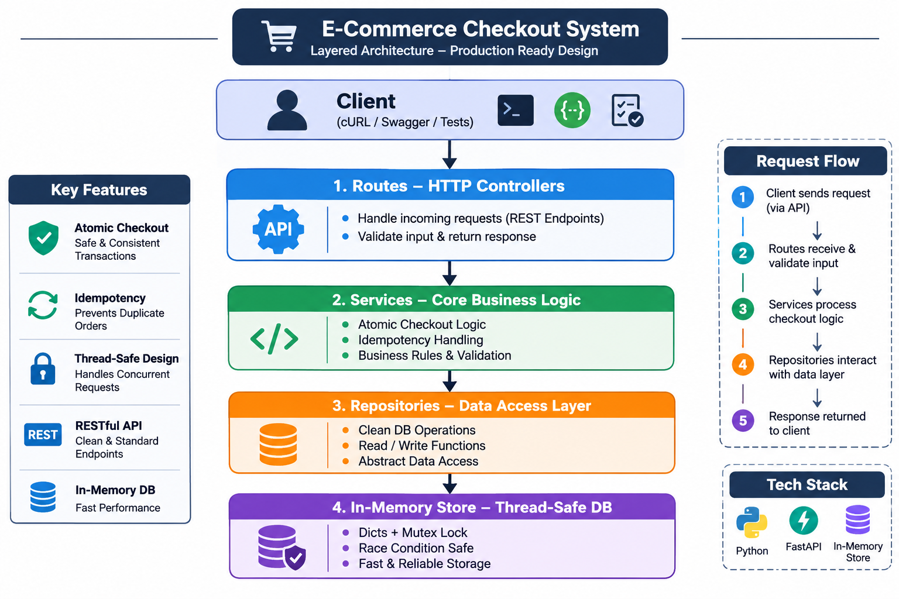

<p align="center">
  <h1 align="center">🛡️ CartGuard API</h1>
  <p align="center">
    <strong>Production-Grade E-Commerce Checkout Service</strong><br/>
    Atomic Transactions · Idempotency · Thread-Safe Concurrency · 98% Test Coverage
  </p>
  <p align="center">
    <a href="https://ecommerce-api-proj.onrender.com/docs"></a>
    <a href="https://ecommerce-api-proj.onrender.com/health"></a>
  </p>
  <p align="center">
    <strong>🌐 Live API Base URL:</strong> <a href="https://ecommerce-api-proj.onrender.com"><code>https://ecommerce-api-proj.onrender.com</code></a><br/>
    <strong>📖 Interactive Swagger Docs:</strong> <a href="https://ecommerce-api-proj.onrender.com/docs"><code>https://ecommerce-api-proj.onrender.com/docs</code></a>
  </p>
  <p align="center">
    
    
    
    
    
    
  </p>
</p>

---

## 📌 What is CartGuard?

CartGuard is a **minimal but production-hardened** e-commerce checkout backend that solves two of the most critical reliability problems in real-world commerce systems:

| Problem | Real-World Impact | CartGuard's Solution |
|---|---|---|
| **Non-Atomic Checkout** | Stock deducted for Item A, but Item B fails → corrupted inventory, no order | Two-Phase Validation: validate ALL items → deduct ALL items in a single locked operation |
| **Duplicate Orders on Retry** | Network timeout → user clicks "Place Order" again → charged twice, two shipments | Idempotency Keys with SHA-256 payload hashing → replay returns original order, never creates duplicates |

---

## 🏗️ System Architecture

<p align="center">
  
</p>

The system follows a strict **Layered Clean Architecture** where concerns are separated into distinct boundaries:

1. **Routes (HTTP Controllers):** Handles incoming REST requests, deserializes payloads, and returns HTTP responses. Thin layer with zero business logic.
2. **Services (Core Business Logic):** Orchestrates the atomic checkout workflow, runs two-phase validation, checks idempotency keys via SHA-256 payload hashes, and enforces business invariants.
3. **Repositories (Data Access Layer):** Abstract interface for read and write operations. Decouples business logic from the underlying storage mechanism.
4. **In-Memory Store (Thread-Safe DB):** Dict-based storage protected by a mutex lock (`threading.Lock`) preventing race conditions and concurrent overselling.

> **Why layered architecture?** Each layer has ONE responsibility. Swapping in-memory storage for PostgreSQL or MongoDB means rewriting only the Repository layer — routes, services, and automated tests stay completely untouched.

---

## ⚙️ Tech Stack

| Layer | Technology | Version | Why Chosen |
|---|---|---|---|
| Language | **Python** | 3.12.3 | Modern typing, clean async support |
| Web Framework | **FastAPI** | 0.115.5 | Auto validation, Swagger docs, async-first |
| Data Validation | **Pydantic v2** | 2.10.2 | Strict type enforcement, 10× faster than v1 |
| ASGI Server | **Uvicorn** | 0.32.1 | Production-grade async server with uvloop |
| Test Runner | **pytest** | 8.3.4 | Industry standard, clean fixture system |
| HTTP Test Client | **httpx** | 0.27.2 | Async-compatible, in-process testing |
| Coverage | **pytest-cov** | 6.0.0 | Line-level test coverage reporting |
| Linter | **ruff** | 0.8.4 | Replaces flake8+black, fastest Python linter |
| Storage | **In-Memory (dict)** | — | Thread-safe with `threading.Lock()` |

---

## 📂 Project Structure

```
cartguard/
├── app/
│   ├── config.py                   # Single source of truth for all constants
│   ├── main.py                     # App factory, lifespan, router registration
│   │
│   ├── models/                     # Pydantic v2 request/response schemas
│   │   ├── product.py              # Product & ProductListResponse
│   │   ├── cart.py                 # StrictPositiveInt, CartResponse, AddItemRequest
│   │   ├── order.py                # Order, OrderItem, OrderStatus enum
│   │   └── checkout.py             # CheckoutRequest, CheckoutResponse
│   │
│   ├── store/
│   │   ├── database.py             # In-memory dicts + threading.Lock
│   │   └── seed.py                 # Initial product catalogue (4 products)
│   │
│   ├── repositories/               # Data access layer (Repository Pattern)
│   │   ├── product_repo.py         # get_stock(), deduct_stock(), restore_stock()
│   │   ├── cart_repo.py            # create(), add_item(), update_item(), remove()
│   │   └── order_repo.py           # create(), get_by_id(), count()
│   │
│   ├── services/                   # Core business logic
│   │   ├── checkout_service.py     # ⭐ Two-phase atomic checkout + thread lock
│   │   └── idempotency_service.py  # ⭐ SHA-256 payload hash, key dedup
│   │
│   ├── routes/                     # HTTP controllers (thin — call services only)
│   │   ├── products.py             # GET  /api/v1/products
│   │   ├── cart.py                 # POST,PATCH,DELETE /api/v1/cart/*
│   │   ├── checkout.py             # POST /api/v1/checkout
│   │   └── orders.py              # GET  /api/v1/orders/{id}
│   │
│   └── exceptions/
│       └── handlers.py             # Domain exceptions → HTTP status codes
│
├── tests/
│   ├── conftest.py                 # Fresh DB state per test via fixtures
│   ├── test_products.py            # Catalogue & stock listing
│   ├── test_cart.py                # Cart CRUD + quantity validation
│   ├── test_checkout.py            # Atomic checkout + partial failure proofs
│   ├── test_idempotency.py         # Retry scenarios + conflict detection
│   ├── test_edge_cases.py          # 404 / 400 error path coverage
│   └── test_concurrency.py         # Race condition + overselling prevention
│
├── scripts/
│   └── demo_test.sh                # Interactive live scenario runner
│
├── docs/
│   ├── decisions.md                # Architecture Decision Records (ADRs)
│   └── assets/architecture.jpg    # System architecture diagram
│
├── Makefile                        # Developer commands (make test, make run...)
├── pytest.ini                      # Pytest config (auto-async, markers)
├── requirements.txt                # Pinned production dependencies
├── requirements-dev.txt            # Pinned dev/test dependencies
└── README.md                       # This file
```

---

## 🚀 Quick Start

### Prerequisites
- Python 3.12+
- `make` (optional but recommended)

### 1. Setup (One Command)

```bash
git clone <repo-url>
cd cartguard

# With make (recommended)
make install

# Or manually
python3 -m venv .venv
source .venv/bin/activate      # Windows: .venv\Scripts\activate
pip install -r requirements-dev.txt
```

### 2. Run the Server

```bash
make run
# or
uvicorn app.main:app --host 127.0.0.1 --port 8000 --reload
```

| URL | Description |
|---|---|
| `http://127.0.0.1:8000/docs` | 📖 Swagger UI — interactive API explorer |
| `http://127.0.0.1:8000/redoc` | 📄 ReDoc documentation |
| `http://127.0.0.1:8000/health` | ❤️ Health check |

---

## 📡 API Reference

### Product Catalogue

```bash
GET /api/v1/products
```
Returns all products with live stock levels.

```json
{
  "products": [
    { "id": "prod_laptop", "name": "Laptop Pro 15", "price": 89999.0, "stock": 10 },
    { "id": "prod_headphones", "name": "Wireless Headphones", "price": 4999.0, "stock": 5 },
    { "id": "prod_usb_hub", "name": "USB-C Hub 7-in-1", "price": 2499.0, "stock": 1 },
    { "id": "prod_webcam", "name": "4K Webcam", "price": 5999.0, "stock": 0 }
  ],
  "total": 4
}
```

### Cart Management

```bash
POST   /api/v1/cart                              # Create empty cart → 201
GET    /api/v1/cart/{cart_id}                    # Fetch cart → 200
POST   /api/v1/cart/{cart_id}/items              # Add/set item → 200
PATCH  /api/v1/cart/{cart_id}/items/{product_id} # Update qty → 200
DELETE /api/v1/cart/{cart_id}/items/{product_id} # Remove item → 200
```

**Quantity Rules:** Only positive whole integers accepted. `0`, `-1`, and `1.5` are **strictly rejected with 422** before reaching business logic.

### Checkout ⭐

```bash
POST /api/v1/checkout
Headers: Idempotency-Key: <unique-uuid-per-attempt>
Body:    { "cart_id": "cart_abc123" }
```

**Success (new order):**
```json
{
  "message": "Order created successfully.",
  "order": {
    "id": "ord_xyz789",
    "cart_id": "cart_abc123",
    "items": [
      { "product_id": "prod_laptop", "product_name": "Laptop Pro 15",
        "quantity": 2, "unit_price": 89999.0, "subtotal": 179998.0 }
    ],
    "total": 179998.0,
    "status": "confirmed",
    "created_at": "2026-11-22T14:00:00Z"
  }
}
```

**Idempotent replay (same key + same payload):**
```json
{ "message": "Order already exists. Returning original order.", "order": { ... } }
```

**Conflict (same key + different payload):** `409 Conflict`

**Out of stock:** `409 Conflict` with detailed failure list per product

### Order Retrieval

```bash
GET /api/v1/orders/{order_id}   # → Full order snapshot
```

---

## 🧪 Test Suite

### Run All Tests

```bash
make test
# or
pytest -v
```

### Run with Coverage Report

```bash
make coverage
# or
pytest -v --cov=app --cov-report=html --cov-report=term-missing
# Open: htmlcov/index.html
```

### Run Live Interactive Demo

```bash
make demo
# or
./scripts/demo_test.sh
```

---

## 📊 Test Results

```
platform linux -- Python 3.12.3, pytest-8.3.4
======== 30 passed in 1.63s ========

TOTAL COVERAGE: 98%  (407 statements, 7 missed)
```

### Test Coverage by Category

| Test File | Tests | What is Verified |
|---|---|---|
| `test_products.py` | 1 | Catalogue listing, all 4 products, correct stock values |
| `test_cart.py` | 9 | Cart CRUD, 6 invalid quantity cases (0, -1, -99, 1.5, 0.99, "abc") |
| `test_checkout.py` | 5 | Multi-item success, exact limit, above limit, zero stock, **partial failure** |
| `test_idempotency.py` | 3 | Same key replay, conflict key, missing header |
| `test_edge_cases.py` | 9 | Health check, 404 order/cart/product, 400 empty cart, 404 cart operations |
| `test_concurrency.py` | 2 | **Race condition: 10 concurrent users, 1 item in stock** |
| **TOTAL** | **30** | **30 / 30 passed** |

---

## 🔬 Core Test Scenarios Explained

### 1. Atomic Partial Failure Test (Critical)

**Scenario:** Cart has 2 items — Laptop (stock: 10, want: 2) and Headphones (stock: 5, want: 10).

```
Expected: Headphones FAILS → BOTH items' stock must remain UNCHANGED
Naive bug: Laptop stock deducted first (8) → Headphones fails → stock corrupted!
```

**What CartGuard does:** Validates ALL items in Phase 1. Zero stock touched. Raises error. Test asserts:
```python
assert product_repo.get_stock("prod_laptop") == 10   # NOT 8!
assert order_repo.count() == 0                        # No orphan order!
```

### 2. Idempotency Retry Test

**Scenario:** Client sends same checkout twice (network timeout simulation).

```python
# Request 1 → creates ord_xyz789, deducts 1 laptop (stock: 10 → 9)
# Request 2 → returns ord_xyz789 (SAME order, NO new deduction)
assert order_ids[0] == order_ids[1]              # Same order returned
assert product_repo.get_stock("prod_laptop") == 9  # Deducted ONCE only
assert order_repo.count() == 1                      # Only 1 order exists
```

### 3. Race Condition / Overselling Test (Advanced)

**Scenario:** 10 users simultaneously buy the LAST USB Hub (stock: 1).

```python
with ThreadPoolExecutor(max_workers=10) as executor:
    results = [executor.submit(checkout, cart) for cart in 10_carts]

assert results.count(200) == 1       # Only 1 succeeded
assert results.count(409) == 9       # 9 correctly rejected
assert product_repo.get_stock("prod_usb_hub") == 0   # Never went negative!
assert order_repo.count() == 1       # Exactly 1 order
```

---

## 🐛 Regression Proof

A realistic defect was introduced to prove the test suite catches real bugs.

### Defect Introduced
In `checkout_service.py`, Phase 1 validation was removed. Stock was deducted greedily **per item** before all items were validated:

```python
# BUGGY CODE (introduced for demo):
for product_id, qty in items.items():
    if stock < qty:
        raise OutOfStockError(...)    # Item 2 fails here
    deduct_stock(product_id, qty)     # ← Item 1 already deducted! BUG!
```

### Test Failure Output (Bug Active)
```
FAILED tests/test_checkout.py::test_multi_item_partial_stock_failure_leaves_all_stock_untouched

AssertionError: REGRESSION DETECTED: First product stock was deducted despite checkout failure!
assert 8 == 10
 +  where 8 = get_stock('prod_laptop')
```

> Notice: HTTP response was still `409` — but our test checked **database state**, not just the status code. Shallow HTTP-only tests would have **missed this bug entirely**.

### After Fix (Two-Phase Validation Restored)
```
tests/test_checkout.py::test_multi_item_..._untouched PASSED   ✅
======================== 30 passed in 1.63s =========================
```

---

## 🚢 Ship / No-Ship Recommendation

### ✅ SHIP — Ready for Production (v1.0.0)

Both release-blocking risks are fully mitigated and verified:

| Risk | Status | Evidence |
|---|---|---|
| Non-atomic checkout corrupts stock | **RESOLVED** | `test_multi_item_partial_stock_failure` asserts DB state, not just HTTP |
| Network retry creates duplicate order | **RESOLVED** | `test_idempotent_retry_same_payload` verifies 1 order, 1 deduction |
| Concurrent overselling | **RESOLVED** | `test_concurrent_checkout_prevents_overselling` — 10 threads, 1 item |
| Invalid quantities accepted | **RESOLVED** | Pydantic `StrictPositiveInt` rejects at API boundary — zero business logic needed |

### ⚠️ Pre-Scale Considerations (Before 10k+ RPS)

These are not blockers for current scope but should be addressed before horizontal scaling:

| Gap | Impact | Recommended Solution |
|---|---|---|
| `threading.Lock()` is single-process only | Breaks under multiple pods | Replace with **Redis Redlock** or **DB row-level locking (`SELECT FOR UPDATE`)** |
| In-memory idempotency keys have no TTL | Memory grows unbounded over time | Move to **Redis with 24-hour TTL** |
| In-memory storage lost on restart | No data persistence | Replace store layer with **PostgreSQL** (only repository files change) |
| No rate limiting on checkout | Vulnerable to DDoS | Add **SlowAPI** or API Gateway rate limiter |

---

## 🛠️ All Developer Commands

```bash
make help       # Show all available commands
make install    # Create venv + install all dependencies
make run        # Start development server (port 8000)
make test       # Run all 30 tests
make coverage   # Run tests + generate htmlcov/index.html
make demo       # Run interactive live scenario script
make lint       # Run ruff linter
make clean      # Remove .coverage, htmlcov/, __pycache__, caches
```

---

## 🌱 Seeded Product Catalogue

| Product | ID | Stock | Price |
|---|---|---|---|
| Laptop Pro 15 | `prod_laptop` | 10 | ₹89,999 |
| Wireless Headphones | `prod_headphones` | 5 | ₹4,999 |
| USB-C Hub 7-in-1 | `prod_usb_hub` | 1 | ₹2,499 |
| 4K Webcam | `prod_webcam` | 0 | ₹5,999 |

> Stock values are intentionally chosen to enable all test scenarios (exact limit, above limit, zero stock, partial failure) without tests interfering with each other — each test gets a fresh seeded database via `conftest.py` fixtures.
